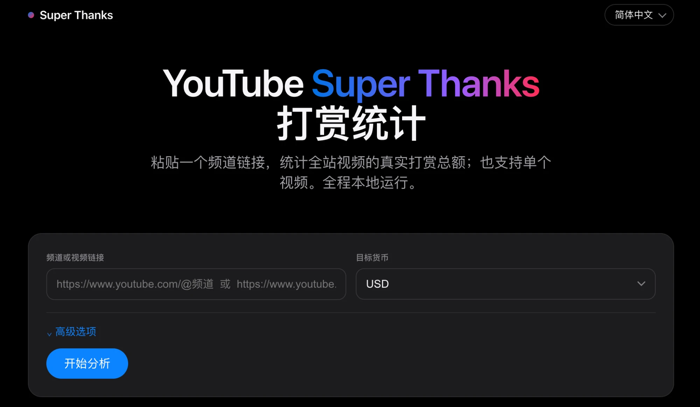

# YouTube Super Thanks — Donation Stats & Viewer

*[English](#english) · [简体中文](#简体中文)*

<p align="center">
  
</p>

Count the **real** "Super Thanks" (超级感谢 / 投げ銭 / 후원) donations across a whole
YouTube channel — not just a single video — and view the results in a clean,
Apple‑style dashboard that opens right in your browser.

- **Scanner** (`yt_superthanks.py`) — a local Python tool that reads the actual
  donation amounts YouTube attaches to paid comments and sums them per channel.
- **Local web UI** (`superthanks_ui.py`) — the same scanner with a live dashboard.
- **Report Viewer** (`index.html`) — a **100% static single page** you can host on
  GitHub Pages. Open it, drop in a report the scanner exported, and see the dashboard.
  No install, nothing uploaded.

Both UIs support **6 languages** (简体中文 / 繁體中文 / English / 日本語 / 한국어 / Español)
and auto‑detect your browser language, with a switcher in the top‑right.

> 🔗 **Live viewer:** https://vicky128.github.io/youtube-superthanks/

> 💡 **Recommended — run it locally.** I personally suggest downloading the repo and
> running the scanner on your own machine (`yt_superthanks.py` or `superthanks_ui.py`).
> It's the most reliable path and gives exact, complete channel totals. The hosted page
> is only a **viewer** for a report you've already generated — it can't scan YouTube itself.
>
> 💡 **更推荐本地运行。** 我个人建议把仓库下载下来，在自己电脑上直接跑扫描器
> （`yt_superthanks.py` 或 `superthanks_ui.py`）——这是最稳、结果最完整准确的方式。
> 线上页面只是用来**查看**你已经生成好的报告，它本身无法扫描 YouTube。

---

## English

### Why this exists

Sites like superthanks.net analyze **one video** at a time. This project totals an
**entire channel**. (It also avoids a bug where some tools double‑count non‑USD tips
as USD — amounts here are parsed from YouTube's real localized strings and converted
with live FX rates.)

### How it works

Donation amounts are **not** in the official YouTube Data API. YouTube's internal
(InnerTube) comment data attaches a paid "chip" to each Super Thanks comment:

```
commentSurfaceEntityPayload.pdgCommentChip.pdgCommentChipRenderer.chipText.simpleText
# e.g. "NT$1,500.00", "MYR 15.00", "€10.00"
```

`yt-dlp` fetches this data (handling pagination/tokens) but discards the chip, so the
scanner hooks its response parser, collects every chip, de‑dupes, parses the localized
currency string, converts to your target currency, and sums. Super Thanks float to the
**top** of the "top comments" sort, so scanning the first ~1–2k comments per video
captures essentially all of them cheaply.

### Install

```bash
pip3 install -U yt-dlp
```

(macOS with Homebrew's `yt-dlp` also works — the script auto‑finds its bundled modules.)

### Scan a channel (CLI)

```bash
# Whole channel, totals in USD
python3 yt_superthanks.py "https://www.youtube.com/@channel" -c USD

# A single video
python3 yt_superthanks.py "https://www.youtube.com/watch?v=VIDEO_ID" -c JPY
```

Writes `superthanks_report.json` and `superthanks_report.csv`. Useful flags:

| Flag | Meaning |
|------|---------|
| `-c, --currency` | Target currency (USD, EUR, TWD, JPY, …). Default USD. |
| `-m, --max-comments` | Comments scanned per video (default `1500`; `all` = exact). |
| `-w, --workers` | Parallel threads (default `4`; 4–8 is safe, higher risks rate limits). |
| `--probe N` | Fast estimate: probe top N, deep‑scan only hits (lossy). |
| `--tabs` | `videos,shorts,streams` (default `videos`). |
| `--limit N` | Only the first N videos. |
| `--cookies-from-browser chrome` | For age‑restricted videos. |
| `--cache` | Resume file (skips already‑scanned videos). |

### Local web UI

```bash
python3 superthanks_ui.py   # opens http://127.0.0.1:8750
```

Paste a channel or video link, pick a currency, hit **Analyze**, and watch live
progress. Export CSV when done.

### Report Viewer (GitHub Pages)

`index.html` is a static page. Host it on GitHub Pages (Settings → Pages → *Deploy from
branch* → `main` / root). Then anyone can open the URL and **drag in a report** the
scanner produced (`.json` or `.csv`) to see the dashboard — all parsing happens locally
in their browser. You can also commit a report to `data/sample.json` (the page loads it
by default) or link to one with `?src=<url>`.

### Why there's no "paste a link and scan" online version

A purely static page **cannot scan YouTube** itself: browsers block cross‑origin
requests to YouTube's internal API (CORS), and `yt-dlp` isn't a browser. So scanning
stays local; the hosted page is a viewer for the reports it produces. A hosted backend
could scan server‑side, but cloud IPs get rate‑limited/blocked by YouTube quickly.

### Notes

- Amounts are **gross** (what viewers paid). Creators keep roughly **70%** after
  YouTube's ~30% cut.
- Live‑stream Super Chat/Stickers are **not** in the comment section and are not counted.
- This reads only **public** comment data. It does **not** show ad revenue — that's
  private to the channel owner (YouTube Studio / Analytics API with the owner's OAuth).

---

## 简体中文

### 它解决什么

superthanks.net 之类只能分析**单个视频**，而这个项目能统计**整个频道**的打赏总额。
金额直接从 YouTube 真实的本地化字符串解析、再按实时汇率换算，避免了某些工具把非美元
打赏当成美元重复计算的 bug。

### 原理

打赏金额**不在**官方 YouTube Data API 里。YouTube 内部（InnerTube）的评论数据会给每条
Super Thanks 评论附一个付费 "chip"：

```
commentSurfaceEntityPayload.pdgCommentChip.pdgCommentChipRenderer.chipText.simpleText
# 例如 "NT$1,500.00"、"MYR 15.00"、"€10.00"
```

`yt-dlp` 会抓到这段数据（自动处理翻页/令牌）但会丢弃这个 chip。扫描器挂钩它的响应解析，
收集全部 chip、去重、解析本地化货币串、换算到目标货币再求和。打赏评论会浮在「热门」排序
**最前面**，所以每个视频扫前 ~1–2k 条评论通常就能抓全，又快又省。

### 安装

```bash
pip3 install -U yt-dlp
```

（macOS 上装了 Homebrew 的 `yt-dlp` 也行——脚本会自动找到它自带的模块。）

### 命令行扫描

```bash
# 整个频道，按 USD 汇总
python3 yt_superthanks.py "https://www.youtube.com/@某频道" -c USD

# 单个视频
python3 yt_superthanks.py "https://www.youtube.com/watch?v=视频ID" -c CNY
```

会生成 `superthanks_report.json` 和 `superthanks_report.csv`。常用参数：

| 参数 | 含义 |
|------|------|
| `-c, --currency` | 目标货币（USD、CNY、TWD、JPY…），默认 USD。 |
| `-m, --max-comments` | 每个视频扫评论上限（默认 `1500`；`all`＝精确）。 |
| `-w, --workers` | 并行线程（默认 `4`；4–8 较稳，太高易被限流）。 |
| `--probe N` | 快速估算：先探测前 N 条，只深扫有打赏的（会少算长尾）。 |
| `--tabs` | `videos,shorts,streams`（默认 `videos`）。 |
| `--limit N` | 只处理前 N 个视频。 |
| `--cookies-from-browser chrome` | 年龄限制视频需要。 |
| `--cache` | 断点续扫缓存。 |

### 本地网页 UI

```bash
python3 superthanks_ui.py   # 自动打开 http://127.0.0.1:8750
```

粘贴频道或视频链接、选货币、点**开始分析**，可看实时进度，完成后可导出 CSV。

### 报告查看器（GitHub Pages）

`index.html` 是纯静态页面。放到 GitHub Pages（Settings → Pages → *Deploy from branch*
→ `main`／根目录）后，任何人打开网址，把扫描器生成的报告（`.json` 或 `.csv`）**拖进去**
即可看到仪表盘——所有解析都在他们自己的浏览器里完成。你也可以把一份报告提交到
`data/sample.json`（页面默认加载它），或用 `?src=<url>` 指向某个报告。

### 为什么没有「贴链接就在线扫」的版本

纯静态页面**无法自己扫 YouTube**：浏览器的跨域（CORS）限制会拦掉对 YouTube 内部接口的
请求，而 `yt-dlp` 不是浏览器。所以扫描只能本地跑，线上页面是报告查看器。要做真·在线扫描
得有后端服务器，但云服务器 IP 很快会被 YouTube 限流/封禁。

### 说明

- 金额是**毛额**（观众支付总额）；博主实际到手约 **70%**（YouTube 抽成约 30%）。
- 直播的 Super Chat/贴纸**不在**评论区，不计入。
- 只读取**公开**评论数据，**不**显示广告收益——那是博主私有的（YouTube Studio／需博主
  本人 OAuth 的 Analytics API）。

---

## License

[MIT](LICENSE)
